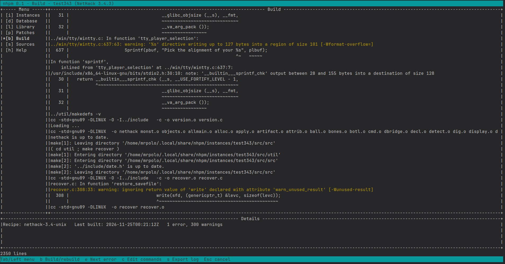

# nhpm

A terminal patch manager for NetHack, written in C with an **ncurses** interface in the style
of `htop` / `menuconfig`, sitting on top of **Quilt**.

It downloads patches from the NetHack Patch Database into a local library, and lets you
create saved **instances**: named NetHack setups, each with its own version, its own ordered
list of patches, its own build and its own save games. It can also turn an instance into one
combined patch, and turn your own changes to the NetHack code into a proper patch.

See [docs/README.md](docs/README.md) for the user guide: installing, a quickstart, the
ncurses interface's keybindings, and the full CLI reference. See
[docs/nhpm-plan.md](docs/nhpm-plan.md) for the full plan and
[docs/features.md](docs/features.md) for what it does, feature by feature. **Status:** both
the command-line mode and the ncurses interface (milestone M7) are functional -- most screens
(Instances, Database, Library, Patches, Build, Sources, the Changes dialog) work; see
[docs/ui-progress.md](docs/ui-progress.md) for exactly what's done and what's left in each.

<p align="center">
  <br>
  <em>Result of building Nethack 3.4.3</em>
</p>

## Building

Needs a C11 compiler, CMake, `ncursesw`+`panel`, `libcurl`, `libxml2` (headers and
libraries), plus `quilt`, `patch`, `make`, `tar`/`gzip`/`unzip`, `diff` and optionally `git`
at runtime. See
[docs/nhpm-plan.md section 1](docs/nhpm-plan.md#1-dependencies-and-build) for package names.

```sh
make            # build ./nhpm
make test       # run the unit/integration tests
```

`make` shells out to the top-level `CMakeLists.txt` for the actual build (so `cmake`/`ctest`
need to be on `PATH`, alongside everything else above); `make`/`make lint` stays what CI runs
and what you should run too -- see CONTRIBUTING.md. Calling `cmake`/`ctest` directly also
works, for IDEs or other generators.

See [CONTRIBUTING.md](CONTRIBUTING.md) for the rest of the development workflow (formatting,
linting, the debug/sanitizer build) and a short version of the code style rules.

## License

The [NetHack General Public License](LICENSE) (NGPL, SPDX identifier `NGPL`), the same
license NetHack itself uses.
